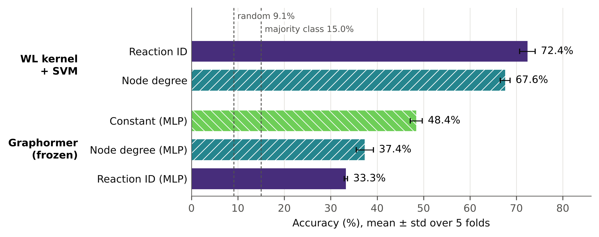

# Graph Transformers vs. Graph Kernels for the Classification of Bacterial Metabolic Pathway Graphs

Code and results of the Master's thesis by **Aniello Di Vaio**
(Alma Mater Studiorum – Università di Bologna, Department of Pharmacy and
Biotechnology, A.Y. 2025/2026), carried out at the University of the Balearic
Islands. Supervisor: Prof. Jairo Enrique Rocha Cárdenas. Internal supervisor:
Prof. Pietro Di Lena.

## What this project does

Each bacterium is represented by the graph of its metabolism: every node is a
biochemical reaction, and a directed edge connects two reactions when a product
of the first is a substrate of the second. The question is whether the
taxonomic group of a bacterium can be predicted from this graph alone.

Two very different approaches are compared on 7,644 bacterial graphs from
[MetaDAG](https://doi.org/10.1186/s12859-025-06048-w), grouped into 11 classes:

- **Graphormer** ([Ying et al., 2021](https://openreview.net/forum?id=OeWooOxFwDa)),
  a Graph Transformer pretrained on ~3.8 million small molecules (PCQM4Mv1),
  used as a **frozen** feature extractor: it is never trained on bacteria. Its
  768-dimensional graph embeddings are classified with Logistic Regression, a
  linear SVM, a Random Forest and an MLP.
- The **Weisfeiler-Lehman (WL) graph kernel**
  ([Shervashidze et al., 2011](https://jmlr.org/papers/v12/shervashidze11a.html)),
  computed with [GraKeL](https://github.com/ysig/GraKeL), with an SVM trained
  directly on the bacterial labels.

Both are tested with different information on the nodes: only the topology
(node degree), nothing at all (constant feature), or the identity of the
reaction (an index into a vocabulary of 4,077 reactions).

## Main results

Stratified 5-fold cross-validation on 7,644 bacteria, 11 classes (random
baseline 9.1%, majority class 15.0%). Accuracy is the mean ± standard
deviation over the 5 folds; for Graphormer the best of the four classifiers
is shown.

| Method | Node information | Accuracy (%) | Macro-F1 |
|---|---|---|---|
| WL kernel + SVM | reaction ID | **72.4 ± 1.7** | 0.706 |
| WL kernel + SVM | node degree | 67.6 ± 1.1 | 0.628 |
| Graphormer (frozen) + MLP | constant | 48.4 ± 1.3 | 0.486 |
| Graphormer (frozen) + MLP | node degree | 37.4 ± 1.8 | 0.368 |
| Graphormer (frozen) + MLP | reaction ID | 33.3 ± 0.4 | 0.324 |



- The frozen Graphormer, pretrained only on small molecules, separates the
  bacterial groups well above chance (48.4%), so part of what it learned
  transfers to metabolic graphs.
- The WL kernel, whose SVM is trained directly on the bacterial labels, is
  clearly better (72.4%), and it improves when the identity of the reactions
  is added (67.6% → 72.4%).
- Graphormer instead gets **worse** with more information on the nodes
  (constant > node degree > reaction ID). Its node-embedding table was trained
  only on the atom features of PCQM4Mv1: the rows used for the reaction IDs
  have the norm of a random initialisation and carry no learned information.
- The ranking of the three Graphormer configurations is the same with all four
  classifiers:

| Graphormer node features | Logistic Regression | Linear SVM | Random Forest | MLP |
|---|---|---|---|---|
| constant | 45.3 ± 0.8 | 45.3 ± 0.8 | 40.3 ± 1.6 | 48.4 ± 1.3 |
| node degree | 36.7 ± 1.1 | 36.3 ± 0.8 | 34.8 ± 0.5 | 37.4 ± 1.8 |
| reaction ID | 32.6 ± 1.1 | 31.7 ± 1.5 | 29.1 ± 1.7 | 33.3 ± 0.4 |

Full results: [`results/all_results.csv`](results/all_results.csv),
per-class F1 in [`results/per_class_f1.csv`](results/per_class_f1.csv),
classification reports in `results/reports/`, confusion matrices in
`results/confusion/` and all figures in `figures/`.

## Repository structure

```
scripts/
  generate_labels.py        1. class labels from the MetaDAG results table
  build_dataset.py          2a. MetaDAG CSV files -> graphs (topology only)
  build_dataset_v2.py       2b. MetaDAG CSV files -> graphs with reaction IDs
  sample_graphs_v2.py       3. reduce every graph to at most 250 nodes
  inference_v2.py           4a. Graphormer embeddings, node feature = degree
  inference_v3.py           4b. Graphormer embeddings, node feature = node.x
  evaluate_all.py           5. all classifiers and WL kernels, 5-fold CV
  make_figures.py           6. result figures from the files of step 5
  visualize_embeddings.py   7. t-SNE / UMAP projections
  legacy/                   earlier and diagnostic scripts (see its README)
results/                    output of evaluate_all.py (final run)
figures/                    output of make_figures.py and visualize_embeddings.py
```

## Data

The data are **not** included in this repository. The metabolic networks were
generated with the MetaDAG web tool
([Palmer-Rodríguez et al., 2025](https://doi.org/10.1186/s12859-025-06048-w)),
which builds organism-specific networks from KEGG
([Kanehisa et al., 2023](https://doi.org/10.1093/nar/gkac963)). The scripts
expect:

```
data/raw/data/Individuals/<organism>/<organism>_R_adj.csv   reaction graph (edge list: source, destination)
Results.csv                                                 MetaDAG table with the KEGG "Categories" of each organism
```

In the reaction graphs a reversible reaction appears twice, as `rX` and
`rX_r`; both are mapped to the same reaction ID.

## Environment

All experiments ran on Ubuntu with an NVIDIA RTX 3090 (24 GB), in a conda
environment with Python 3.9. The official Graphormer `install.sh` targets
PyTorch 1.9.1 + CUDA 11.1 and could not be used, so the dependencies were
installed by hand:

```bash
conda create -n graphormer python=3.9 -y && conda activate graphormer
git clone --recursive https://github.com/microsoft/Graphormer.git

pip install "cython<3.0" "numpy>=1.20,<1.24"
pip install torch==2.0.1+cu118 --index-url https://download.pytorch.org/whl/cu118
pip install torch-scatter torch-sparse torch-cluster torch-spline-conv pyg-lib \
    -f https://data.pyg.org/whl/torch-2.0.1+cu118.html
pip install torch-geometric==2.3.1

pip install "pip<24.1" --upgrade          # needed for omegaconf 2.0.5 metadata
pip install omegaconf==2.0.5 --no-deps
pip install pyyaml tensorboard tensorboardX "protobuf<3.20" bitarray cffi \
    "hydra-core>=1.0.7,<1.1" regex sacrebleu
cd Graphormer/fairseq && pip install . && python setup.py build_ext --inplace && cd ../..

pip install grakel==0.1.8 scikit-learn pandas matplotlib umap-learn
```

Two patches were needed: `GraphormerPYGDataset` needs `len()` and `get()`
methods to work with PyTorch Geometric 2.x, and fairseq refuses a `--user-dir`
folder literally named `graphormer`, so the source folder was copied to
`graphormer_src`. The inference scripts add these folders to `sys.path` with
absolute paths (`/home/aniello/thesis/models/graphormer...`): adapt them to
your installation.

### Pretrained checkpoint

The original Microsoft checkpoints are no longer downloadable. The
PCQM4Mv1 Graphormer-Base checkpoint distributed on Hugging Face
(`clefourrier/graphormer-base-pcqm4mv1`) was used instead, after renaming its
`classifier.*` keys to `encoder.*`; the three auxiliary output layers missing
from that checkpoint are left at initialisation (`strict=False`). They are
not used: the graph embedding is read from the virtual node at the output of
the final layer norm, before any output layer.

## Pipeline, step by step

All commands are run from the project folder.

**1. Labels.** The taxonomic group of each organism is the second field of the
KEGG `Categories` string. The 10 most represented of the 47 groups become
classes; the others are merged into *Other*.

```bash
python scripts/generate_labels.py --results Results.csv --output data/labels/bacteria_labels.csv
```

**2. Graphs.** One graph per organism, as PyTorch Geometric objects.
`build_dataset.py` stores only the topology; `build_dataset_v2.py` also builds
the vocabulary of 4,077 reactions and stores the reaction index of every node
in `x`.

```bash
python scripts/build_dataset.py \
    --data_dir data/raw/data/Individuals --labels data/labels/bacteria_labels.csv \
    --output data/processed/bacteria_dataset.pt
python scripts/build_dataset_v2.py \
    --data_dir data/raw/data/Individuals --labels data/labels/bacteria_labels.csv \
    --output data/processed/bacteria_dataset_v2.pt --vocab_output data/processed/reaction_vocab.json
```

**3. Sampling.** Graphormer computes all shortest paths with Floyd-Warshall,
O(n³), and its attention is O(n²). The graphs have 985.6 nodes on average
(18 to 1,738), so each graph is reduced to its 250 nodes of highest total
degree; edges are kept when both ends are kept, and graphs with ≤ 250 nodes
(282 of 7,644) are unchanged.

```bash
python scripts/sample_graphs_v2.py \
    --dataset data/processed/bacteria_dataset_v2.pt \
    --output data/processed/bacteria_dataset_v2_250_fixed.pt
```

**4. Graphormer embeddings.** One forward pass per graph with frozen weights;
the embedding is the 768-dimensional output of the virtual node.

```bash
# node feature = reaction ID
python scripts/inference_v3.py --dataset data/processed/bacteria_dataset_v2_250_fixed.pt \
    --output embeddings/bacteria_embeddings_v2_fixed.pt
```

The three Graphormer configurations were produced as follows:

| Configuration | Graphs | Sampling | Inference | Embeddings |
|---|---|---|---|---|
| node degree | `build_dataset.py` | `legacy/sample_graphs.py` | `inference_v2.py` (recomputes the out-degree of every node and uses it as node feature) | `bacteria_embeddings.pt` |
| constant | `build_dataset_v2.py` | `legacy/sample_graphs.py` (overwrites all node features with 1) | `inference_v3.py` | `bacteria_embeddings_v2.pt` |
| reaction ID | `build_dataset_v2.py` | `sample_graphs_v2.py` | `inference_v3.py` | `bacteria_embeddings_v2_fixed.pt` |

`inference_v2.py` ignores the stored node features, so the node-degree
configuration is not affected by the sampling bug described below.
`inference_v2.py` was first written for a preliminary experiment on archaea:
its docstring and the class summary it prints still refer to that dataset.

**5. Evaluation.** Every configuration is evaluated with the same stratified
5-fold cross-validation (shuffled, seed 42, identical folds for all methods,
organisms aligned by their KEGG code). Embedding classifiers run in a
`Pipeline(StandardScaler, classifier)`. The WL kernel (3 iterations,
normalised, vertex-histogram base kernel) is computed with two kinds of
initial labels, node degree (`out-degree // 3`, capped at 10) and reaction ID,
and used with an SVM on the precomputed kernel.

```bash
python scripts/evaluate_all.py --out_dir results/final
```

**6–7. Figures.**

```bash
python scripts/make_figures.py --results results/final --fig_dir figures
python scripts/visualize_embeddings.py --fig_dir figures
```

## A note on the sampling bug

An earlier version of the sampling script (`scripts/legacy/sample_graphs.py`)
replaced the node features of every sampled graph with a constant. With the
reaction-ID dataset this silently erased the reaction IDs of 96.3% of the
graphs, so a result first reported as "Graphormer with reaction IDs" was in
fact obtained with constant node features. The bug was found with
`scripts/legacy/check_features.py`, fixed in `sample_graphs_v2.py`, and the
reaction-ID experiment was repeated. Both results are reported above with
their correct names.

## References

- Ying C. et al. *Do Transformers Really Perform Badly for Graph Representation?* NeurIPS 2021.
- Shi Y. et al. *Benchmarking Graphormer on Large-Scale Molecular Modeling Datasets.* arXiv:2203.04810, 2022.
- Hu W. et al. *OGB-LSC: A Large-Scale Challenge for Machine Learning on Graphs.* arXiv:2103.09430, 2021.
- Shervashidze N. et al. *Weisfeiler-Lehman Graph Kernels.* JMLR 12:2539–2561, 2011.
- Siglidis G. et al. *GraKeL: A Graph Kernel Library in Python.* JMLR 21(54):1–5, 2020.
- Palmer-Rodríguez P. et al. *MetaDAG: a web tool to generate and analyse metabolic networks.* BMC Bioinformatics 26:31, 2025.
- Kanehisa M. et al. *KEGG for taxonomy-based analysis of pathways and genomes.* Nucleic Acids Research 51(D1):D587–D592, 2023.
